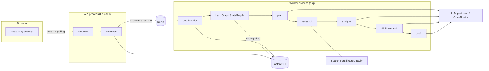

# AgentFlow

**Human-in-the-loop multi-agent research orchestrator.** Submit a research question, watch
specialised agents plan it, retrieve evidence, check every claim against its sources, and
approve the report before it can be exported.

> **Status: in active development — Milestone 1 of 8.**
> This README documents what is *implemented*, not what is planned. The status table below is
> the authoritative list. Nothing here claims to be production-tested, and no live deployment
> exists yet.

---

## The problem

An analyst comparing options across the public web repeats the same unpaid work every time:
decompose the question, search, skim, track which source actually said what, and assemble
something a colleague will trust. A chatbot answer collapses all of that into one opaque
paragraph — the sub-questions, the sources consulted, the claims that *weren't* supported, and
the decision to publish all disappear.

AgentFlow makes each of those steps a durable, inspectable artifact, and puts a human approval
gate in front of publication.

## How it works



Five nodes, each a single schema-validated LLM call over text the system already holds:

| Node | Responsibility |
|---|---|
| `plan` | Decompose the question into at most 4 bounded subtasks |
| `research` | Retrieve sources per subtask through the configured search port (**no LLM call**) |
| `analyse` | Synthesise findings, each tied to retrieved sources |
| `citation_check` | Adjudicate whether each claim is supported by a retrieved source |
| `draft` | Produce the report with citations and a generated limitations section |

Then the graph **interrupts**. The job ends — no process sits waiting — and the task rests in
`awaiting_approval` until a human approves or requests a revision, at which point a resume job
continues the graph from its checkpoint.

### Two design decisions worth calling out

**The model never gets internet access.** Our code performs the search; each node is one
structured-output call over text we already hold. The *graph* is the agent, not a tool-calling
loop. This removes an entire class of runaway-agent and SSRF failure modes.

**Retrieved web content is untrusted input.** It is delimited and labelled as data, the model
has no tools at synthesis time, every node returns a schema-validated object, and citation
identifiers are re-bound against the sources actually retrieved — a model cannot invent a
citation that survives. See [`docs/security.md`](docs/security.md).

## Honest terminology

The `citation_check` node verifies **that a claim points to a retrieved source**. It does not
verify that the claim is true. AgentFlow makes no factual-accuracy guarantee, and the report's
limitations section is generated from actual run data (search mode, model served per node,
source count, unsupported-claim count, token spend) so it cannot drift from reality.

## Technology

| Layer | Choice |
|---|---|
| API | Python 3.12, FastAPI, Pydantic v2 |
| Orchestration | LangGraph (graph + `interrupt()` + Postgres checkpointer only) |
| Worker / queue | arq over Redis |
| Database | PostgreSQL, SQLAlchemy 2.0 async, Alembic |
| LLM | Provider-agnostic OpenAI-compatible gateway; OpenRouter by default |
| Search | Pluggable port: offline fixtures (default) or Tavily |
| Frontend | React 19, TypeScript, Vite, Tailwind, TanStack Query |
| Quality | ruff, mypy, import-linter, pytest, Vitest, gitleaks |

**No model ID appears in application code.** Every model is resolved from environment
variables and validated against the provider catalogue at startup — see
[`docs/model-configuration.md`](docs/model-configuration.md).

## Implementation status

| Milestone | Scope | Status |
|---|---|---|
| M1 | Walking skeleton + LLM config spine | **in progress** |
| M2 | Fixture vertical slice, approval gate, restart recovery | not started |
| M3 | Live OpenRouter gateway, capability negotiation, cost ledger | not started |
| M4 | Tavily search, URL safety, rate limits, retention | not started |
| M5 | Complete frontend | not started |
| M6 | Verification, documentation, evaluation harness | not started |
| M7 | Deployment and public repository | not started |
| M8 | Completion report | not started |

## Quick start

Prerequisites: Docker Desktop, and [uv](https://docs.astral.sh/uv/) for backend work outside
containers.

```bash
cp .env.example .env          # then edit .env — it is gitignored
docker compose up --build
```

| Service | URL |
|---|---|
| Frontend | http://localhost:8080 |
| API docs | http://localhost:8000/docs |
| Readiness | http://localhost:8000/ready |

AgentFlow runs with **no API keys at all** in its default configuration: `LLM_PROVIDER=stub`
and `SEARCH_PROVIDER=fixture` give a fully deterministic offline demo. Fixture and stub output
is labelled as such in the UI and is never presented as live AI.

See [`docs/development.md`](docs/development.md) for running the API, worker and frontend
outside Docker, and [`docs/testing.md`](docs/testing.md) for the test commands.

## Documentation

| Document | Contents |
|---|---|
| [`docs/architecture.md`](docs/architecture.md) | Components, boundaries, process model |
| [`docs/model-configuration.md`](docs/model-configuration.md) | Model matrix, capability validation, costs |
| [`docs/data-model.md`](docs/data-model.md) | Entities, relationships, indexes |
| [`docs/api.md`](docs/api.md) | Endpoints, schemas, errors |
| [`docs/security.md`](docs/security.md) | Trust boundaries, injection defence, secret handling |
| [`docs/testing.md`](docs/testing.md) | Test categories and verified results |
| [`docs/decisions.md`](docs/decisions.md) | Architecture decision records |

## Licence

MIT — see [LICENSE](LICENSE).
