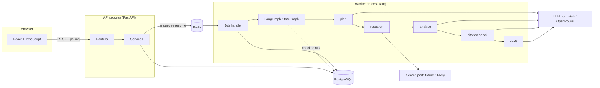

# AgentFlow

**Human-in-the-loop multi-agent research orchestrator.** Submit a research question, watch
specialised agents plan it, retrieve evidence, check every claim against its sources, and
approve the report before it can be exported.

> **Status: in active development — Milestone 4 of 8.**
> This README documents what is *implemented*, not what is planned. The status table below is
> the authoritative list. Nothing here claims to be production-tested, and no live deployment
> exists yet.

---

## The problem

An analyst comparing options across the public web repeats the same unpaid work every time:
decompose the question, search, skim, track which source actually said what, and assemble
something a colleague will trust. A chatbot answer collapses all of that into one opaque
paragraph — the sub-questions, the sources consulted, the claims that *weren't* supported, and
the decision to publish all disappear.

AgentFlow makes each of those steps a durable, inspectable artifact, and puts a human approval
gate in front of publication.

## How it works



Five nodes, each a single schema-validated LLM call over text the system already holds:

| Node | Responsibility |
|---|---|
| `plan` | Decompose the question into at most `MAX_SUBTASKS` bounded subtasks |
| `research` | Retrieve sources per subtask through the configured search port (**no LLM call**) |
| `analyse` | Synthesise findings, each tied to retrieved sources |
| `citation_check` | Adjudicate whether each claim is supported by a retrieved source |
| `draft` | Produce the report with citations and a generated limitations section |

Three limits are enforced **after** the model returns rather than merely requested in the
prompt: the subtask count is truncated, source references are resolved against sources
actually retrieved (anything that does not resolve is dropped), and a `supported` verdict
with no resolvable source is downgraded to `unsupported`.

Then the graph **interrupts**. The job ends — no process sits waiting — and the task rests in
`awaiting_approval` until a human approves or requests a revision, at which point a resume job
continues the graph from its checkpoint.

### Two design decisions worth calling out

**The model never gets internet access.** Our code performs the search; each node is one
structured-output call over text we already hold. The *graph* is the agent, not a tool-calling
loop. This removes an entire class of runaway-agent and SSRF failure modes.

**Retrieved web content is untrusted input.** It is delimited and labelled as data, the model
has no tools at synthesis time, every node returns a schema-validated object, and citation
identifiers are re-bound against the sources actually retrieved — a model cannot invent a
citation that survives.

The corpus contains a red-team document carrying an injected directive, and it is genuinely
retrieved on the demo query. The test suite drives a **deliberately compromised model** that
obeys that directive completely: it still cannot self-approve the report, its fabricated
citations do not resolve, its "mark everything supported" verdicts are downgraded, and the
limitations section still reports the truth.

This is **containment, not prevention.** Whether a model obeys an injected instruction is a
property of that model; this project does not measure it and claims nothing about it. See
[`docs/security.md`](docs/security.md).

### Live web search

With `SEARCH_PROVIDER=tavily` the research node retrieves real pages. Three things are worth
knowing about how it behaves:

- **URLs are canonicalised before storage.** Tracking parameters, fragments, default ports
  and host case are stripped, and the `url_sha256` digest is taken from that canonical form,
  so two links to the same page become one source rather than two citations.
- **Unsafe URLs are rejected, not repaired.** Scheme allowlist, no embedded credentials, no
  loopback, private, link-local or cloud-metadata addresses, no bare hostnames.
- **A failed search fails its subtask and nothing else.** The failure is counted and
  disclosed in the report's limitations; it is *never* backfilled from the fixture corpus.
  Only if every subtask fails does the task fail.

Operational guards: `SEARCH_MAX_PER_TASK` caps searches per task so a runaway plan costs one
task rather than the month's allowance, write endpoints are rate-limited per session, and a
nightly sweep deletes research content past `DATA_RETENTION_DAYS`.

## Honest terminology

The `citation_check` node verifies **that a claim points to a retrieved source**. It does not
verify that the claim is true. AgentFlow makes no factual-accuracy guarantee, and the report's
limitations section is generated from actual run data (search mode, model served per node,
source count, unsupported-claim count, token spend) so it cannot drift from reality.

## Technology

| Layer | Choice |
|---|---|
| API | Python 3.12, FastAPI, Pydantic v2 |
| Orchestration | LangGraph (graph + `interrupt()` + Postgres checkpointer only) |
| Worker / queue | arq over Redis |
| Database | PostgreSQL, SQLAlchemy 2.0 async, Alembic |
| LLM | Provider-agnostic OpenAI-compatible gateway; OpenRouter by default |
| Search | Pluggable port: offline fixtures (default) or Tavily |
| Frontend | React 19, TypeScript, Vite, Tailwind, TanStack Query |
| Quality | ruff, mypy, import-linter, pytest, Vitest, gitleaks |

**No model ID appears in application code.** Every model is resolved from environment
variables and validated against the provider catalogue at startup — see
[`docs/model-configuration.md`](docs/model-configuration.md).

## Implementation status

| Milestone | Scope | Status |
|---|---|---|
| M1 | Walking skeleton + LLM config spine | complete |
| M2 | Fixture research workflow, approval gate, restart recovery | complete |
| M3 | Live OpenRouter gateway, free profile, cost ledger | complete |
| M4 | Live Tavily search, URL safety, rate limits, retention | **complete — awaiting review** |
| M5 | Complete frontend | not started |
| M6 | Verification, documentation, evaluation harness | not started |
| M7 | Deployment and public repository | not started |
| M8 | Completion report | not started |

## What exists today (end of M4)

The complete research workflow runs end to end and is verified in Docker: submit a question,
and the five nodes plan it, retrieve sources, synthesise findings, check each claim against
those sources, and draft a report with citations and a generated limitations section. The
workflow then pauses; a reviewer can read the report, send it back with a note, or approve
it — and only an approved report can be exported.

**With live providers configured, the research is real.** A verified run retrieved 17
sources from the public web through Tavily, produced a report with 48 citation links — none
of which resolved to anything outside the sources actually retrieved — went through a
revision round and was approved and exported. Full evidence:
[`docs/milestones/m4-report.md`](docs/milestones/m4-report.md).

**With the default configuration, results are deterministic fixture output, not AI
research.** `LLM_PROVIDER=stub` and `SEARCH_PROVIDER=fixture` run a stub model adapter
against a committed corpus of synthetic documents: no language model is called and no web
search happens. Every report carries a notice saying which combination produced it — the
notice is derived from the sources actually stored, not from configuration — every source is
labelled, and the API reports `offline_mode: true`.

What that buys: the whole system — including approval, revision, export restrictions,
restart recovery and prompt-injection containment — is exercisable by anyone who clones the
repository, with no API keys and no spend.

**Retrieved is not verified.** Claim checking establishes that a retrieved source *states*
a claim. It is not a fact check, and it offers no protection against a source being wrong.
Reports say so in their own limitations section.

## Quick start

Prerequisites: Docker Desktop, and [uv](https://docs.astral.sh/uv/) for backend work outside
containers.

```bash
cp .env.example .env          # then edit .env — it is gitignored
docker compose up --build
```

| Service | URL |
|---|---|
| Frontend | http://localhost:8080 |
| API docs | http://localhost:8000/docs |
| Readiness | http://localhost:8000/ready |

AgentFlow runs with **no API keys at all** in its default configuration: `LLM_PROVIDER=stub`
and `SEARCH_PROVIDER=fixture` give a fully deterministic offline demo. Fixture and stub output
is labelled as such in the UI and is never presented as live AI.

To run real models without spending anything, use the **free development profile** — see
[`docs/model-configuration.md`](docs/model-configuration.md). `LLM_FREE_MODELS_ONLY=true`
refuses any model with non-zero published pricing, at startup and before every call, so a
billable request cannot be made by accident. Free endpoints are slow and rate-limited and
their analysis quality is materially weaker; they exist to exercise the workflow, not to
produce output worth relying on. No security control or structured-output requirement is
relaxed to accommodate them.

Every published host port is configurable in `.env` (`API_PORT`, `FRONTEND_PORT`,
`POSTGRES_HOST_PORT`, `REDIS_HOST_PORT`), which matters if you already run Postgres or Redis
locally — a clash shows up as `Bind for 127.0.0.1:5433 failed: port is already allocated`.

Verify the whole stack end to end:

```bash
scripts/smoke-test.sh http://localhost:8080            # submit -> gate -> approve
scripts/restart-recovery-test.sh http://localhost:8080 # kill the worker, prove recovery
```

The first submits a task, waits for the approval gate, approves it, and checks idempotency,
double-approval rejection and session scoping. The second restarts the worker mid-flight and
again while the task is parked at the gate, then exercises revision, approval and export —
asserting that no step, source or report is duplicated. Each prints `PASSED` or exits
non-zero.

See [`docs/development.md`](docs/development.md) for running the API, worker and frontend
outside Docker, and [`docs/testing.md`](docs/testing.md) for the test commands.

## Documentation

| Document | Contents |
|---|---|
| [`docs/architecture.md`](docs/architecture.md) | Components, boundaries, process model |
| [`docs/model-configuration.md`](docs/model-configuration.md) | Model matrix, capability validation, costs |
| [`docs/data-model.md`](docs/data-model.md) | Entities, relationships, indexes |
| [`docs/api.md`](docs/api.md) | Endpoints, schemas, errors |
| [`docs/security.md`](docs/security.md) | Trust boundaries, injection defence, secret handling |
| [`docs/testing.md`](docs/testing.md) | Test categories and verified results |
| [`docs/decisions.md`](docs/decisions.md) | Architecture decision records |
| [`docs/milestones/m4-report.md`](docs/milestones/m4-report.md) | Live web research: what was verified, and what was not |

## Licence

MIT — see [LICENSE](LICENSE).
