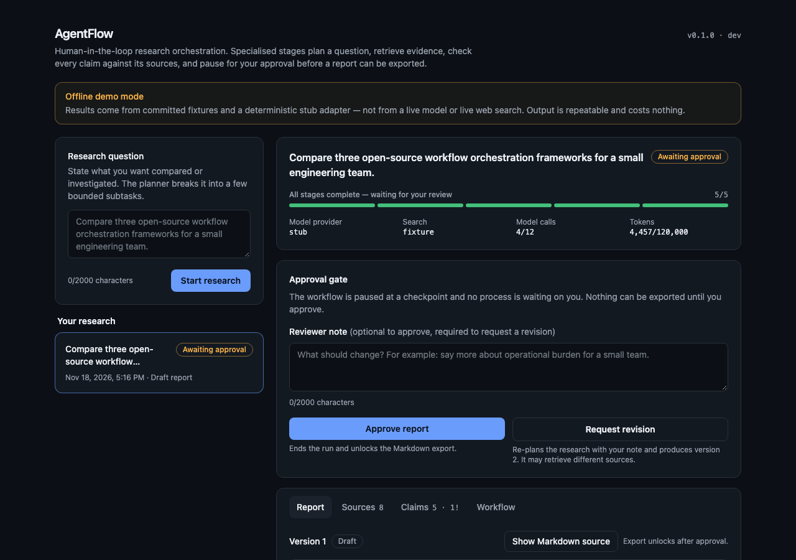
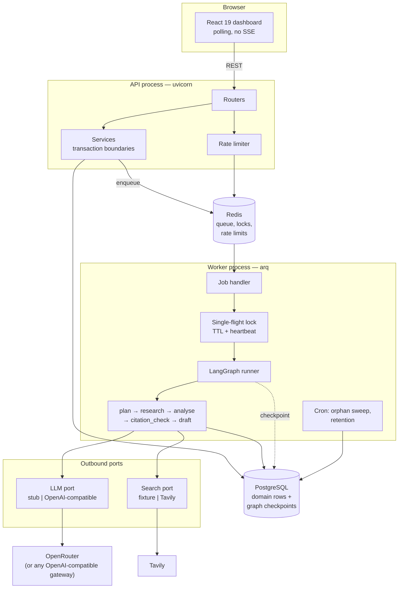
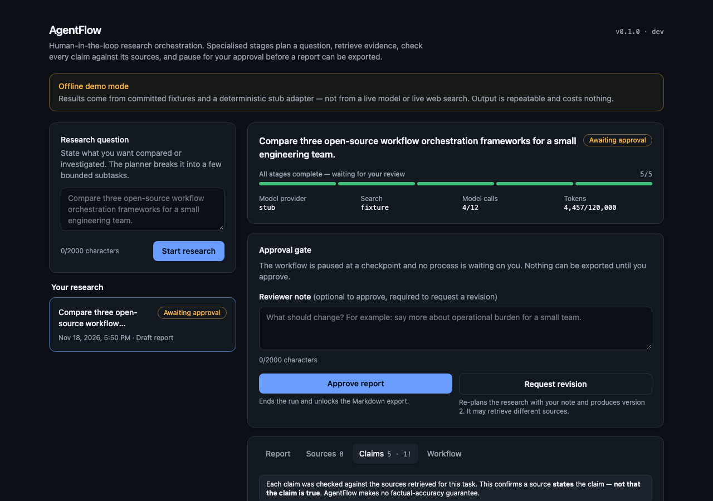
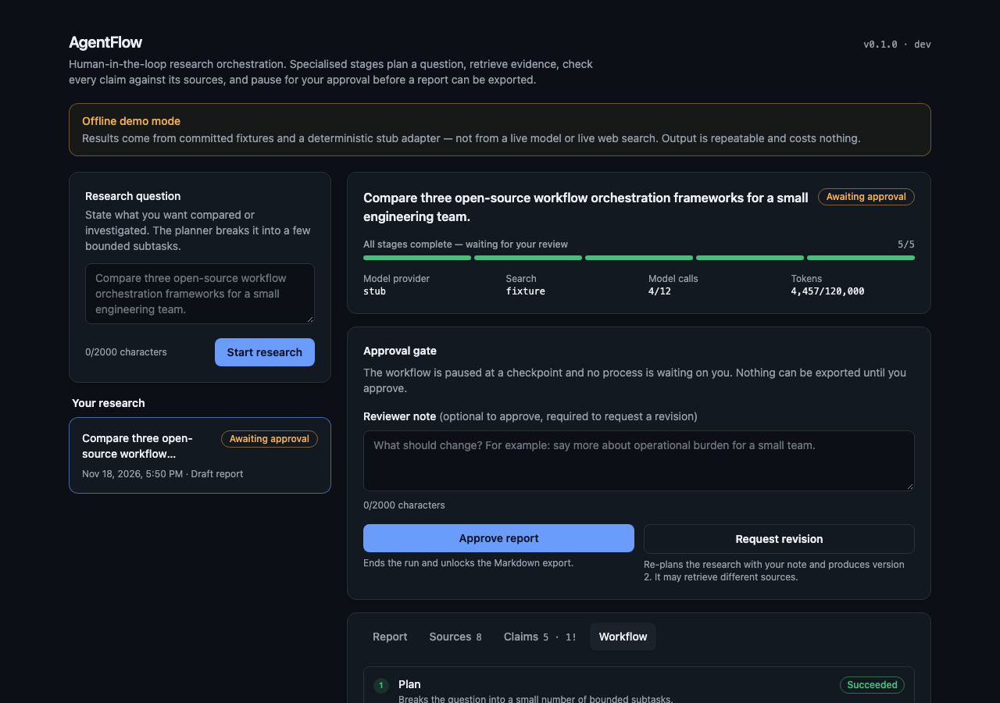
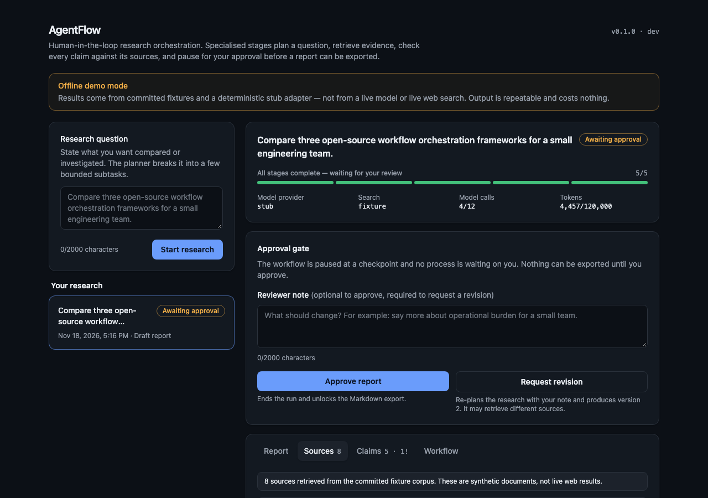
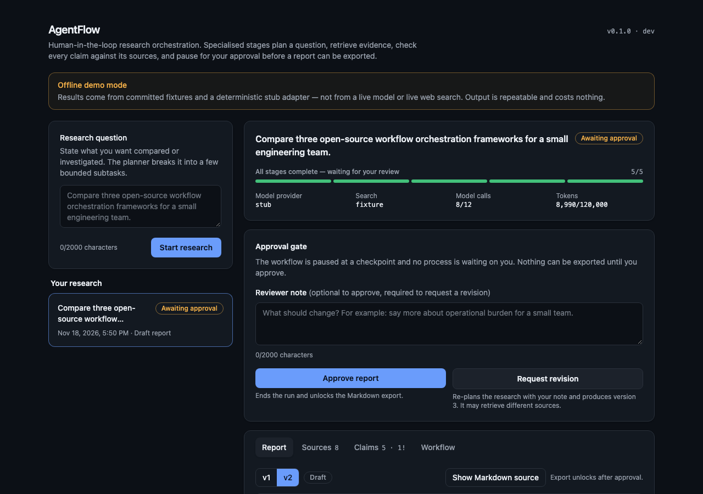

# AgentFlow

**A human-in-the-loop research orchestrator that refuses to assert what it cannot cite.**

Submit a research question. Five graph stages plan it, retrieve evidence, synthesise findings,
check every claim against the sources actually retrieved, and draft a report. The workflow then
**pauses for a human** — and nothing can be exported until a reviewer approves it.

> **Status: in active development — Milestone 8 of 8.** Everything documented here is
> implemented and verified; the status table below says what is not. The application has never
> run anywhere but a local Docker host.



*The actual application. The amber banner is not decoration: this run used the deterministic
stub adapter and the committed fixture corpus, and the UI says so rather than presenting
fixture output as AI research.*

---

## The problem

An LLM asked to research something will produce a confident, well-formatted answer whether or
not it has grounds for one. The failure is not that the prose is bad — it is that a reader
cannot tell which sentences are supported, which are extrapolated, and which are invented. For
anything consequential, a person has to re-do the work to find out.

Two things follow. Automation should make the *grounding* inspectable rather than hiding it
behind fluent output, and a human should remain in the loop at the point where a decision is
actually made.

## The solution

AgentFlow treats a claim with no retrievable source as a defect to surface, not an
embarrassment to smooth over.

- **Every claim is bound to evidence that was actually retrieved.** The model emits citation
  labels; our code re-resolves them against the sources in the database, drops anything that
  does not resolve, and **downgrades a "supported" verdict with no resolvable source to
  "unsupported"**. A model cannot invent a citation that survives.
- **The report discloses its own limits.** Source count, subtasks, unsupported claims, which
  model wrote it, which provider retrieved the sources, and the spend — all generated from the
  run's own rows, so the prose cannot drift from what happened.
- **A human approves before anything leaves.** The graph interrupts and the job *ends* — no
  process sits waiting — and export returns 409 until a reviewer approves.
- **Nothing is called verified.** Claim checking establishes that a retrieved source *states* a
  claim. It is not a fact check, and the system says so in the UI, in the report and in these
  docs.

How well does that work? With a wide evidence set the pipeline supports 80% of its claims; when
retrieval returns a single source, **it declines to support 80% of them** — while citation
integrity stays at 100%. Those numbers come from a [reproducible evaluation](#evaluation), and
they measure the grounding pipeline, not a model's intelligence.

## Key engineering capabilities

| | |
|---|---|
| **Durable human-in-the-loop** | LangGraph `interrupt()` plus a Postgres checkpointer. The pause consumes no compute and survives a restart of every process. |
| **Provider-agnostic LLM gateway** | One OpenAI-compatible port, OpenRouter by default. No model ID appears in application code; each stage's model resolves from an environment variable and is validated against the provider catalogue at startup. |
| **Negotiated structured output** | Three tiers (native JSON Schema → forced tool call → prompt-and-parse). Strict mode refuses anything below tier one rather than silently degrading. |
| **Crash recovery** | A short-TTL Redis lock with a heartbeat, plus a sweep that re-queues tasks whose worker died. Verified by SIGKILLing a worker mid-run in Docker. |
| **Idempotency** | `UNIQUE(task_id, node, attempt)`, report versions derived from the revision round, and an `Idempotency-Key` on submission. A re-delivered job is harmless. |
| **Prompt-injection containment** | Retrieved content is fenced as data, the model gets no tools, output is schema-validated, and citations are re-bound. Tested by driving a *deliberately compromised* model that obeys the injected instruction — it still cannot self-approve, and its fabricated citations still do not resolve. |
| **Enforced architecture** | `import-linter` fails the build if a layer or a vendor SDK leaks across its boundary. |
| **Cost control** | Per-task token, call and search ceilings checked before each request, and a free-models-only mode that refuses any model with non-zero published pricing. |

## Architecture



**One codebase, two process types.** The API validates, persists and enqueues; it never calls a
model, because a research run takes minutes and a request handler must not hold one. The worker
owns every model and search call, and a task's rows are written only by the worker holding its
lock — exactly one writer per task.

**The model never gets internet access.** Our code performs the search; each stage is one
structured-output call over text we already hold. The *graph* is the agent, not a tool-calling
loop, which removes a class of runaway-agent and SSRF failure modes rather than mitigating it.

Full detail, including end-to-end and recovery sequence diagrams:
[`docs/architecture.md`](docs/architecture.md).

### The workflow

| Stage | Does | Calls a model |
|---|---|---|
| `plan` | Breaks the question into at most `MAX_SUBTASKS` bounded subtasks | yes |
| `research` | Retrieves sources per subtask, normalises and deduplicates URLs | **no** |
| `analyse` | Synthesises findings, each tied to retrieved sources | yes |
| `citation_check` | Adjudicates whether a retrieved source states each claim | yes |
| `draft` | Writes the report, citations and a generated limitations section | yes |

Then the graph interrupts and waits for a person.

## Technology

| Layer | Choice |
|---|---|
| API | Python 3.12, FastAPI, Pydantic v2 |
| Orchestration | LangGraph (graph + `interrupt()` + Postgres checkpointer only) |
| Worker / queue | arq over Redis |
| Database | PostgreSQL, SQLAlchemy 2.0 async, Alembic |
| LLM | Provider-agnostic OpenAI-compatible gateway; OpenRouter by default |
| Search | Pluggable port: committed fixtures (default) or Tavily |
| Frontend | React 19, TypeScript, Vite, Tailwind v4, TanStack Query |
| Quality | ruff, mypy, import-linter, pytest, Vitest, Playwright, axe-core, gitleaks |

## Quick start

Prerequisites: Docker Desktop, and [uv](https://docs.astral.sh/uv/) plus
[pnpm](https://pnpm.io/) for work outside containers.

```bash
git clone https://github.com/snmshahzaib/agentflow.git
cd agentflow
cp .env.example .env     # works as-is; no credentials needed
docker compose up --build
```

| Service | URL |
|---|---|
| Dashboard | http://localhost:8080 |
| API docs | http://localhost:8000/docs |
| Readiness | http://localhost:8000/ready |

**No API keys at all are required.** The default configuration — `LLM_PROVIDER=stub`,
`SEARCH_PROVIDER=fixture` — runs the complete workflow against a deterministic stub adapter and
a committed corpus of synthetic documents. The whole system, including approval, revision,
export restrictions, crash recovery and injection containment, is exercisable by anyone who
clones the repository, with no spend.

Every published port is configurable in `.env` (`API_PORT`, `FRONTEND_PORT`,
`POSTGRES_HOST_PORT`, `REDIS_HOST_PORT`), which matters if you already run Postgres or Redis
locally.

### Running with live providers (optional, still free)

The offline profile is the default and needs nothing. To run against real models and the real
web:

```bash
# Models, via OpenRouter — any OpenAI-compatible gateway works
LLM_PROVIDER=openrouter
LLM_API_KEY=<your key>
LLM_MODEL_DEFAULT=<a model id>       # no model ID is hardcoded anywhere
LLM_FREE_MODELS_ONLY=true            # refuses anything with non-zero pricing

# Live web research, via Tavily
SEARCH_PROVIDER=tavily
SEARCH_API_KEY=<your key>
```

Both have free allowances that need no payment card. `LLM_FREE_MODELS_ONLY=true` refuses any
model with non-zero published pricing — at startup *and* before every call, checking every
pricing field, because a non-zero request fee makes a nominally free model billable. Full
matrix in [`docs/model-configuration.md`](docs/model-configuration.md).

**What was actually verified live** (M3/M4, free models only, $0.00 total):

- A complete lifecycle on live providers: 17 real sources retrieved from the public web, 48
  citation links of which **none resolved outside the sources actually retrieved**, a revision
  round, approval and export.
- Three distinct model vendors observed serving requests, recorded per call rather than
  inferred from model IDs.
- Every call used tier-one structured output; strict mode never silently downgraded.

Free endpoints are slow, rate-limited and materially weaker. They exist to exercise the
workflow, not to produce research worth relying on. No security control or structured-output
requirement is relaxed to accommodate them.

**On a shared deployment, live research is gated.** Without a valid access code a task is
forced onto the offline profile — downgraded, not refused — so a public demo keeps working and
cannot spend anything.

## The demo workflow

1. **Submit a question.** Client-side validation refuses something too short before a round
   trip; the API returns `202` with a `Location` header and queues the work.
2. **Watch it run.** The dashboard polls and names the current stage — "Stage 2 of 5: Retrieve
   sources" — with every stage, its duration and any retries in the Workflow tab.
3. **Read the evidence.** Sources carry the label used in the report's citations and state
   whether each was retrieved live or came from the fixture corpus. Claims carry a support
   verdict and the sources behind it.
4. **Decide.** Approve, or send it back with a note. A revision re-plans the research — it may
   retrieve different sources — and produces a new version while keeping the old one readable.
5. **Export.** Markdown download unlocks only after approval.

| | |
|---|---|
|  |  |
| **Claim support.** Counted by verdict, with the wording that this shows a source *states* a claim, not that it is true. | **Workflow timeline.** Every stage in order, including ones not yet reached; retries stay visible rather than being overwritten. |
|  |  |
| **Sources.** Each labelled as it appears in citations, with live-versus-fixture stated per source. | **Versions.** A revision supersedes its predecessor without deleting it; both stay readable. |

The exported Markdown is the document the reviewer approved, and
[the raw source is one click away](docs/screenshots/06-markdown-source.png) so what is approved
is what ships.

## Testing and verification

Everything below is a measured result from a real run, not an estimate.

| Suite | Count | Notes |
|---|---|---|
| Backend unit | 282 | no database needed |
| Backend integration | 170 | real Postgres and Redis |
| **Backend total** | **452** | includes admission, abuse and concurrency suites |
| Live abuse run | 21 checks | against the real stack, including a genuine Redis outage |
| Frontend components | 58 | Vitest + Testing Library |
| Browser end-to-end | 34 | Playwright against the **real stack**; Chromium, plus the critical journey on Firefox |
| Accessibility | — | axe-core: **zero** WCAG 2.1 A/AA violations across five views |
| Grounding evaluation | 7 cases | all invariants hold; see below |
| Live provider | 20 | skipped without credentials; evidence preserved from M3/M4 |

```bash
docker compose up -d postgres redis

scripts/with-services.sh uv run pytest        # backend
cd frontend && pnpm test && pnpm lint         # frontend
scripts/e2e-test.sh                           # 34 browser tests, real stack
scripts/smoke-test.sh http://localhost:8080   # submit → gate → approve
scripts/restart-recovery-test.sh http://localhost:8080   # kill the worker, prove recovery
scripts/abuse-check.sh http://localhost:8080  # limits, isolation, Redis outage
make verify                                   # lint, types, boundaries, tests
```

`scripts/with-services.sh` derives connection strings from the running containers, so the
documented commands work from a clean checkout rather than assuming a local Postgres.

The browser suite drives the **real** API, worker, Postgres and Redis in the offline profile —
nothing on the happy path is mocked. It covers the full journey through to the bytes of the
downloaded Markdown, keyboard-only operation, hostile report content in a real engine, and
layout at three viewports.

### Evaluation

A deterministic harness scores the grounding pipeline across seven cases
([`docs/evaluation-baseline.json`](docs/evaluation-baseline.json)):

```
case                    src  clm   cite   grnd   uniq  unsup   util
broad_evidence            9    5   100%   100%   100%    20%    44%
single_subject            5    5   100%   100%   100%    20%    80%
scarce_evidence           1    5   100%   100%   100%    80%   100%
no_methodology            1    5   100%   100%   100%    80%   100%
off_corpus                2    5   100%   100%   100%    60%   100%
injected_evidence         5    5   100%   100%   100%    20%    80%
duplicate_pressure        5    5   100%   100%   100%    20%    80%
```

As evidence shrinks from nine sources to one, the share of claims the system declines to
support rises from 20% to 80% — while **citation resolution and grounded support never leave
100%**. That is the design working: a claim citing `S4` when retrieval returned one source is
downgraded, not asserted.

**This measures the grounding pipeline, not model quality.** On the offline profile the model
is the deterministic stub, whose claims are fixed; what varies per case is the evidence. No
figure here says anything about a live model's output.

## Security and abuse prevention

Full detail in [`docs/security.md`](docs/security.md).

### Admission control

Four checks run before a task row is written or a job is queued, serialised by a Postgres
advisory lock so they hold when requests arrive together rather than in turn:

| Control | Behaviour |
|---|---|
| **Access code** | Gates live research. Without one, a task is forced onto the offline profile — downgraded, not refused. A deployment that forgets to configure a code is closed, not open. |
| **Daily ceilings** | Deployment-wide task and spend limits per UTC day, counted with an upsert rather than read-modify-write. Spend comes from the ledger's own estimate. |
| **Per-session limit** | Tasks one visitor may hold at once. Failed and cancelled tasks do not count — an outage must not become the visitor's quota problem. |
| **Rate limiting** | Per session, per endpoint, with `Retry-After`. Fails **open** if Redis is unreachable, because a limiter that rejects when its own store is down turns a blip into an outage. |

The admitted providers are written to the task row and **the worker obeys that record rather
than re-reading configuration** — so a task admitted to the offline profile stays there even
with live credentials loaded in the same process. That is the difference between a control and
a suggestion.

Verified against a running stack, not just with fakes: 12 simultaneous submissions from one
session give exactly 5 accepted and 7 refused against a limit of 5; stopping Redis mid-flight
leaves reads working, returns 503 with no broker detail leaked, and recovers without an API
restart. `scripts/abuse-check.sh` runs all 21 checks.

### Trust boundaries

- **Retrieved content is untrusted input.** It is fenced and labelled as data, never placed in
  a system prompt, and the model is offered no tools at synthesis time.
- **URLs are never dereferenced server-side.** The search provider returns excerpts; we use
  them. That removes the SSRF surface rather than mitigating it.
- **Validation rejects, it does not repair.** Scheme allowlist, no embedded credentials, no
  loopback, private, link-local or cloud-metadata hosts. Canonicalisation is a separate
  function with a separate purpose.
- **The report is rendered as hostile input.** No raw HTML is parsed, only safe URL schemes
  become links, and every external link carries `rel="noopener noreferrer"` — pinned by
  seventeen component tests and six browser tests, because each property is a library default
  a change could silently remove.
- **A strict CSP** with no `unsafe-inline` and no `unsafe-eval`, plus `nosniff`, `DENY` framing
  and a referrer policy. A browser test drives the whole journey under the policy and fails on
  any violation.
- **Secrets never enter the repository.** gitleaks runs pre-commit and in CI over full history;
  only `*.example` files are tracked.

**Injection is contained, not prevented.** Whether a model obeys an injected instruction is a
property of that model; this project does not measure it and claims nothing about it. What is
tested is that obedience does not help: a compromised model still cannot self-approve, its
fabricated citations still do not resolve, and the limitations section still reports the truth.

## Known limitations

Stated because a portfolio project that lists none is not being honest.

- **Not deployed.** It has run only on a local Docker host. Five gates must be cleared before
  any public deployment — access control, a daily spend ceiling, per-session task limits, rate
  limiting reviewed under real traffic, and hosted secret handling. Three of those are
  currently settings that do nothing, and are labelled as such in the code, in `.env.example`
  and in the docs.
- **No performance or load figures.** None are measured, so none are claimed.
- **Live evidence is from free models only.** The paid profile is implemented, disabled and
  untested. Free preview models are materially weaker, and the live results were produced with
  them.
- **Claim checking is not fact checking.** It establishes that a retrieved source states a
  claim. A wrong source yields a wrong claim marked "supported".
- **No screen-reader testing.** axe-core checks the semantics are present; nobody has driven
  the app with VoiceOver or NVDA.
- **Single browser engine for most tests.** Chromium runs all 33 specs; Firefox runs the
  critical journey only.
- **Retention has never deleted a real expired task.** The sweep is implemented, scheduled and
  tested, but nothing in any environment is yet seven days old.

## Project status

| Milestone | Scope | Status |
|---|---|---|
| M1 | Walking skeleton + LLM config spine | complete |
| M2 | Fixture research workflow, approval gate, restart recovery | complete |
| M3 | Live OpenRouter gateway, free profile, cost ledger | complete |
| M4 | Live Tavily search, URL safety, rate limits, retention | complete |
| M5 | Review UI, browser end-to-end tests, accessibility | complete |
| M6 | Documentation, verification, evaluation harness | complete |
| M7A | Deployment preparation, hosting assessment, security gates | complete |
| M7B | Publication readiness | complete |
| M8 | Final review and publication preparation | **complete — awaiting review** |
| M8 | Completion report | not started |

Each milestone has a report in [`docs/milestones/`](docs/milestones/) recording what was
verified, what was not, and what went wrong.

## Documentation

| Document | Contents |
|---|---|
| [`docs/architecture.md`](docs/architecture.md) | Components, boundaries, process model, sequence diagrams |
| [`docs/data-model.md`](docs/data-model.md) | Entities, relationships, indexes |
| [`docs/api.md`](docs/api.md) | Endpoints, schemas, errors |
| [`docs/model-configuration.md`](docs/model-configuration.md) | Model matrix, capability validation, costs |
| [`docs/security.md`](docs/security.md) | Trust boundaries, injection containment, deployment gates |
| [`docs/testing.md`](docs/testing.md) | Every suite, what it asserts, and the gaps |
| [`docs/evaluation.md`](docs/evaluation.md) | The grounding harness and how to run it |
| [`docs/deployment.md`](docs/deployment.md) | Hosting architecture, secret handling, health checks, rollback |
| [`docs/decisions.md`](docs/decisions.md) | 20 architecture decision records |
| [`CONTRIBUTING.md`](CONTRIBUTING.md) | How to run the checks, and the house rules |
| [`SECURITY.md`](SECURITY.md) | What the design guarantees, and how to report an issue |
| [`docs/milestones/m6-report.md`](docs/milestones/m6-report.md) | What M6 verified, and what it found wrong |
| [`docs/milestones/m7a-report.md`](docs/milestones/m7a-report.md) | Hosting assessment and the five security gates |
| [`docs/milestones/m7b-publication-readiness.md`](docs/milestones/m7b-publication-readiness.md) | Security audit and publication readiness |
| [`docs/milestones/m8-publication-checklist.md`](docs/milestones/m8-publication-checklist.md) | Final checklist: verified facts, and remaining risks |
| [`docs/development.md`](docs/development.md) | Running outside Docker |

## Licence

MIT — see [LICENSE](LICENSE).
