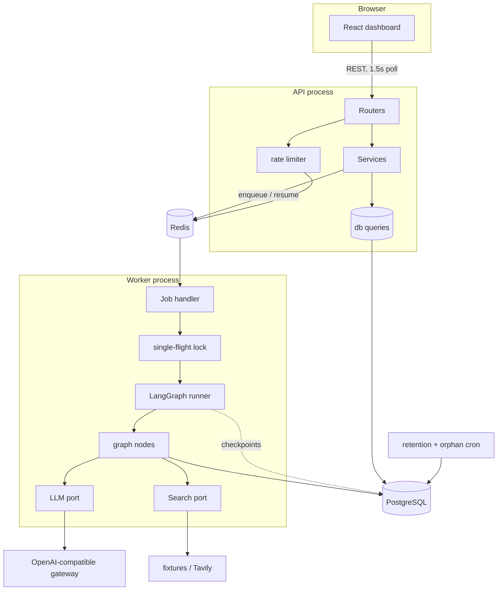
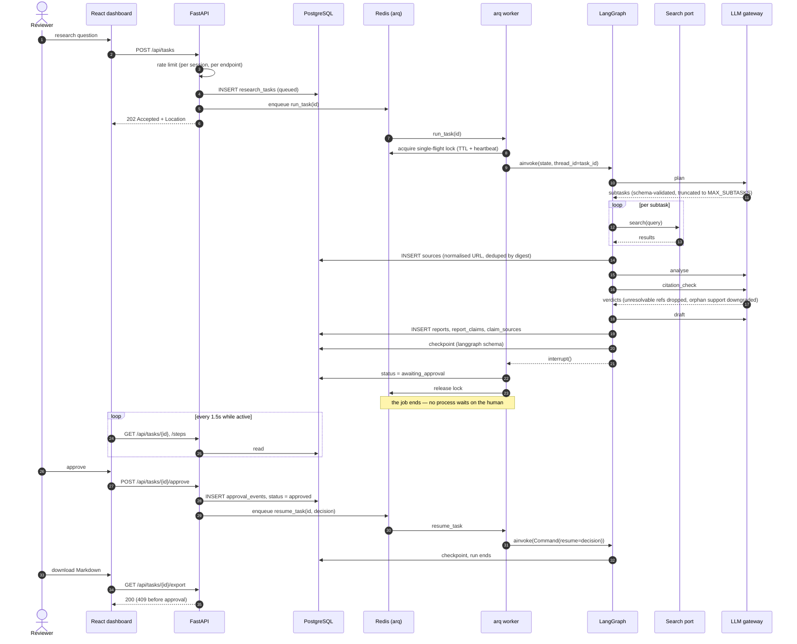
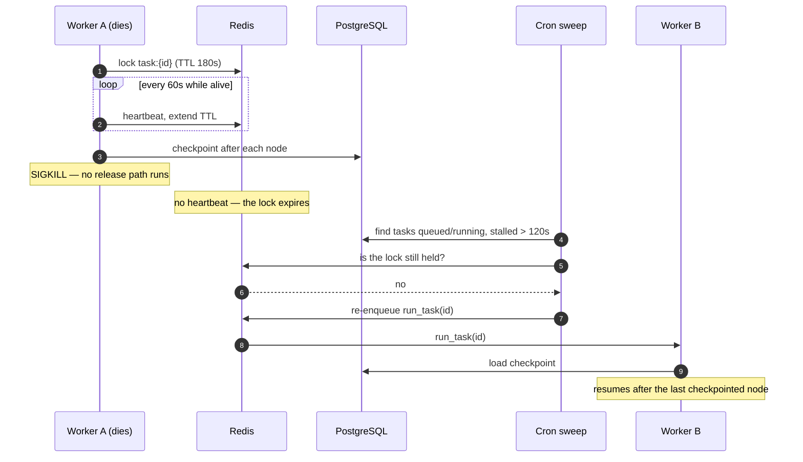

# Architecture

> Diagrams describe the **implemented** system. Components not yet built are absent, not drawn
> as planned. Verified against the code at M6; every box, arrow and table row below corresponds
> to something that runs.

## Process model

Two process types over one codebase and one image, plus PostgreSQL and Redis.

| Process | Entrypoint | Responsibility | Calls an LLM? |
|---|---|---|---|
| API | `uvicorn app.main:app` | HTTP, validation, persistence, enqueue | no |
| Worker | `arq app.workers.settings.WorkerSettings` | graph execution, search, LLM calls | yes |

The API enqueues; the worker executes. A task's rows are written only by the worker holding its
single-flight Redis lock, so there is exactly one writer per task. See ADR-001.

## Layers

```
app.api | app.workers        entrypoints (peers; must not import each other)
       app.graph             orchestration: the worker drives the graph
       app.services          use cases, transaction boundaries
       app.db                SQLAlchemy models and queries
       app.domain            pure types and rules, framework-free
app.adapters.{llm,search,queue}   outbound ports; import domain/core only
```

`app.api` and `app.workers` are peers that may not import each other: the API
enqueues work and the worker executes it, communicating through Redis and the
database rather than in-process. `app.graph` sits below `app.workers` because
the worker drives the graph, never the reverse.

Enforced by `import-linter` contracts in `backend/.importlinter`, run in CI:

- `app.domain` imports no framework and no other app package.
- Vendor SDKs (`openai`) may be imported only inside `app.adapters`.
- Adapters may not import `api`, `db`, `services`, `graph` or `workers`.

Because this is a single deployable, the network cannot enforce these boundaries — so a failing
contract is a red build instead.

## Component view



## Workflow

Five nodes; only four call an LLM.

| Node | Input | Output | LLM |
|---|---|---|---|
| `plan` | question, constraints, reviewer note | ≤`MAX_SUBTASKS` subtasks + a search query each | yes |
| `research` | search queries | sources, deduplicated per task by URL digest | **no** — search port |
| `analyse` | sources | findings, each bound to retrieved sources | yes |
| `citation_check` | findings, sources | per-claim support verdicts | yes |
| `draft` | verdicts | report + claims + evidence links | yes |

Then the graph interrupts and the job ends. See [`diagrams/approval-flow.md`](diagrams/approval-flow.md).

Three limits are enforced by our code **after** the model returns, rather than
only requested in the prompt:

- the subtask count is truncated to `MAX_SUBTASKS`, so a model returning
  twelve subtasks cannot multiply retrieval and spend;
- source references are resolved against sources actually retrieved, and
  anything that does not resolve is dropped;
- a `supported` or `partial` verdict with no resolvable source is downgraded
  to `unsupported`.

### A task, end to end



A revision follows the same path, except the resume command carries
`request_revision`, the graph re-enters at `plan`, and the run ends at the gate
again with a new report version.

### Revision

A reviewer sending a report back re-enters the graph at `plan`, not at
`draft`: the note can change the plan and bring in different sources, which is
usually what a reviewer actually wants. Each round re-plans and re-retrieves,
so rounds are capped by `MAX_REVISION_ROUNDS`.

The report version is derived from the revision round rather than from a
counter. That is what makes the draft node idempotent — a re-run within a
round targets the same version and rewrites it instead of inserting a second
report.

### Recovery after a worker dies

A worker killed with SIGKILL never runs its release path. The task lock
therefore runs on a short TTL refreshed by a heartbeat, so a dead worker's
lock expires in minutes; a cron sweep then re-queues tasks that look stalled
and hold no lock.



A task a live worker still owns is left alone — adopting it would create the
second writer the lock exists to prevent — and a task awaiting approval is
never adopted, because re-running it would discard the report under review.

A node interrupted *between finishing and being checkpointed* does re-run.
That is correct and visible: the re-run is recorded as a new attempt, and the
timeline shows both.

## The model gateway

One provider-agnostic port (`app.adapters.llm`) over the OpenAI-compatible
Chat Completions shape, with OpenRouter as the default gateway.

| Concern | Where |
|---|---|
| The port every node calls | `app/adapters/llm/base.py` (`LLMClient`) |
| The only module importing a vendor SDK | `app/adapters/llm/openai_compat.py` |
| Deterministic offline implementation | `app/adapters/llm/stub.py` |
| Catalogue, capability validation, pricing | `app/adapters/llm/capabilities.py` |
| Per-node model resolution | `app/core/config.py` (`NODE_MODEL_ENV_VARS`) |

Four properties worth stating:

**No model ID appears in application code.** Each node's model resolves from an
environment variable, validated against the provider's catalogue at startup, so
an unknown or incapable model fails the boot rather than the hundredth request.
A pre-commit hook rejects a hardcoded model ID outside the adapter.

**Structured output is negotiated, not assumed.** Three tiers — native JSON
Schema, forced tool call, prompt-and-parse — and with
`LLM_REQUIRE_STRUCTURED_OUTPUT=true` (the live default) anything below tier one
is refused rather than silently downgraded (ADR-008).

**Spend is bounded before the call.** Per-task token and call budgets are
checked ahead of each request, and `LLM_FREE_MODELS_ONLY` refuses any model
with non-zero published pricing — checking every pricing field, because a
non-zero request fee makes a nominally free model billable.

**Every call is recorded.** `llm_calls` holds the model requested, the model
served, the company that served it, the output tier used, tokens, latency,
cost and outcome. The report's limitations section is generated from those
rows, so it cannot drift from what actually happened.

## The search layer

The search port has two implementations and the nodes cannot tell them apart. Which one runs
is configuration (`SEARCH_PROVIDER`), and the resolved mode is stored on the task, so a
report can state what actually produced it rather than what was configured at read time.

| Concern | Where it is handled |
|---|---|
| Provider protocol | `app/adapters/search/base.py` |
| Committed offline corpus | `app/adapters/search/fixture.py` |
| Live retrieval, retries, `Retry-After` | `app/adapters/search/tavily.py` |
| Canonicalisation and the dedup digest | `app/adapters/search/urls.py` (`normalise_url`, `url_digest`) |
| Safety rejection | `app/adapters/search/urls.py` (`validate_url`) |
| Per-task cap, per-subtask failure isolation | `app/graph/nodes/research.py` |

Three properties are worth stating explicitly because they are easy to get wrong:

**AgentFlow never dereferences a source URL.** The provider supplies the excerpt; we use it.
That removes the SSRF surface rather than mitigating it (ADR-013), at the cost of shallower
excerpts than full page text would give.

**Canonicalisation and validation are different operations.** One produces a storage form,
the other rejects. Validation never repairs a URL, because a repaired hostile URL is an
accepted one (ADR-014).

**A failed search never becomes substitute data.** The subtask yields nothing, the failure is
counted and disclosed in the report, and only a total failure fails the task (ADR-015).

## The frontend

One React application, served as a static bundle by nginx, which also proxies
`/api` so the browser sees a single origin and the session cookie needs no
cross-site relaxation.

| Concern | Where |
|---|---|
| Routes and shell | `src/App.tsx` — `/` and `/tasks/:taskId`, section in `?view=` |
| Typed API client, one error envelope | `src/services/api.ts` |
| Query hooks, polling, invalidation | `src/hooks/useApi.ts` |
| Report rendering, treated as hostile input | `src/components/Markdown.tsx`, `src/lib/urls.ts` |
| ARIA tabs | `src/components/Tabs.tsx` |
| Task detail, gate, evidence panels | `src/features/tasks/` |

Three structural decisions:

**State lives in the URL, not in a component.** The task id is a path segment
and the open section a query parameter, so a reviewer can link a colleague to
exactly what they are looking at and a reload keeps the selection (ADR-020).

**Polling, not server-sent events** (ADR-006). The status of a task is also
part of the query key for everything scoped to that task, which is
load-bearing rather than incidental: polling stops the moment a task leaves
`running`, so without it the last poll before the transition is the final word
— and it happens before the steps, sources, claims and report exist. Arriving
at the approval gate is itself a refetch.

**The report is rendered, and rendered as hostile input** (ADR-019). It is
model-written text quoting retrieved pages. No raw HTML is parsed, only
`http`/`https`/`mailto` URLs become links, and every link carries
`rel="noopener noreferrer"`.

## Scheduled work

The worker runs two crons alongside its job handlers:

| Job | Schedule | Purpose |
|---|---|---|
| `recover_orphaned_tasks` | every 2 minutes, and at startup | re-queue tasks whose worker died abruptly |
| `purge_expired_tasks` | daily at 03:17, not at startup | delete research content past `DATA_RETENTION_DAYS` |

The retention sweep deliberately does not run at startup: a restart loop would otherwise
purge repeatedly. It hard-deletes, and the cascades take sources, reports, claims, evidence
links, approvals and ledger rows with the task — a deletion that leaves the retrieved
excerpts behind has not deleted the part that matters.

## State ownership

Two stores exist and their roles do not overlap:

| Store | Authoritative for | Consumed by |
|---|---|---|
| Domain tables (`research_tasks`, `workflow_steps`, …) | display, audit, API responses | API, UI, tests |
| LangGraph checkpoints (`langgraph` schema) | resume-after-restart only | worker |

Both are written in the same unit of work, so they cannot diverge. Nothing reads the
checkpointer to answer an API request.

## Trust boundaries

1. Browser → API: untrusted input; validated by Pydantic at the edge; session-scoped access.
2. Search provider → worker: **untrusted content.** Never executed, never placed in a system
   prompt, never allowed to influence control flow. See [`security.md`](security.md).
3. Worker → LLM gateway: outbound only; no tools are exposed to the model.

The model has no network access of any kind. Our code performs the search; each node is one
structured-output call over text the system already holds.
