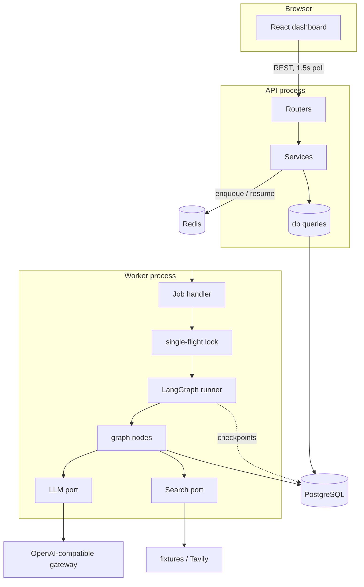

# Architecture

> Diagrams describe the **implemented** system. Components not yet built are absent, not drawn
> as planned. Current milestone: M1.

## Process model

Two process types over one codebase and one image, plus PostgreSQL and Redis.

| Process | Entrypoint | Responsibility | Calls an LLM? |
|---|---|---|---|
| API | `uvicorn app.main:app` | HTTP, validation, persistence, enqueue | no |
| Worker | `arq app.workers.settings.WorkerSettings` | graph execution, search, LLM calls | yes |

The API enqueues; the worker executes. A task's rows are written only by the worker holding its
single-flight Redis lock, so there is exactly one writer per task. See ADR-001.

## Layers

```
app.api | app.workers | app.graph     entrypoints and orchestration
        app.services                  use cases, transaction boundaries
        app.db                        SQLAlchemy models and queries
        app.domain                    pure types and rules, framework-free
app.adapters.{llm,search}             outbound ports; import domain/core only
```

Enforced by `import-linter` contracts in `backend/.importlinter`, run in CI:

- `app.domain` imports no framework and no other app package.
- Vendor SDKs (`openai`) may be imported only inside `app.adapters`.
- Adapters may not import `api`, `db`, `services`, `graph` or `workers`.

Because this is a single deployable, the network cannot enforce these boundaries — so a failing
contract is a red build instead.

## Component view



## Workflow

Five nodes; only four call an LLM.

| Node | Input | Output | LLM |
|---|---|---|---|
| `plan` | question, constraints | ≤4 bounded subtasks | yes |
| `research` | subtasks | sources with excerpts | **no** — search port |
| `analyse` | sources | findings tied to sources | yes |
| `citation_check` | findings, sources | per-claim support verdicts | yes |
| `draft` | findings, verdicts | report markdown + limitations | yes |

Then the graph interrupts and the job ends. See [`diagrams/approval-flow.md`](diagrams/approval-flow.md).

## State ownership

Two stores exist and their roles do not overlap:

| Store | Authoritative for | Consumed by |
|---|---|---|
| Domain tables (`research_tasks`, `workflow_steps`, …) | display, audit, API responses | API, UI, tests |
| LangGraph checkpoints (`langgraph` schema) | resume-after-restart only | worker |

Both are written in the same unit of work, so they cannot diverge. Nothing reads the
checkpointer to answer an API request.

## Trust boundaries

1. Browser → API: untrusted input; validated by Pydantic at the edge; session-scoped access.
2. Search provider → worker: **untrusted content.** Never executed, never placed in a system
   prompt, never allowed to influence control flow. See [`security.md`](security.md).
3. Worker → LLM gateway: outbound only; no tools are exposed to the model.

The model has no network access of any kind. Our code performs the search; each node is one
structured-output call over text the system already holds.
