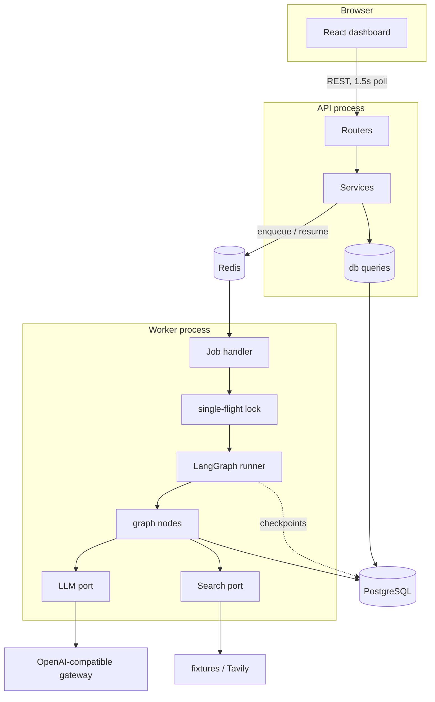

# Architecture

> Diagrams describe the **implemented** system. Components not yet built are absent, not drawn
> as planned. Current milestone: M1.

## Process model

Two process types over one codebase and one image, plus PostgreSQL and Redis.

| Process | Entrypoint | Responsibility | Calls an LLM? |
|---|---|---|---|
| API | `uvicorn app.main:app` | HTTP, validation, persistence, enqueue | no |
| Worker | `arq app.workers.settings.WorkerSettings` | graph execution, search, LLM calls | yes |

The API enqueues; the worker executes. A task's rows are written only by the worker holding its
single-flight Redis lock, so there is exactly one writer per task. See ADR-001.

## Layers

```
app.api | app.workers        entrypoints (peers; must not import each other)
       app.graph             orchestration: the worker drives the graph
       app.services          use cases, transaction boundaries
       app.db                SQLAlchemy models and queries
       app.domain            pure types and rules, framework-free
app.adapters.{llm,search,queue}   outbound ports; import domain/core only
```

`app.api` and `app.workers` are peers that may not import each other: the API
enqueues work and the worker executes it, communicating through Redis and the
database rather than in-process. `app.graph` sits below `app.workers` because
the worker drives the graph, never the reverse.

Enforced by `import-linter` contracts in `backend/.importlinter`, run in CI:

- `app.domain` imports no framework and no other app package.
- Vendor SDKs (`openai`) may be imported only inside `app.adapters`.
- Adapters may not import `api`, `db`, `services`, `graph` or `workers`.

Because this is a single deployable, the network cannot enforce these boundaries — so a failing
contract is a red build instead.

## Component view



## Workflow

Five nodes; only four call an LLM.

| Node | Input | Output | LLM |
|---|---|---|---|
| `plan` | question, constraints, reviewer note | ≤`MAX_SUBTASKS` subtasks + a search query each | yes |
| `research` | search queries | sources, deduplicated per task by URL digest | **no** — search port |
| `analyse` | sources | findings, each bound to retrieved sources | yes |
| `citation_check` | findings, sources | per-claim support verdicts | yes |
| `draft` | verdicts | report + claims + evidence links | yes |

Then the graph interrupts and the job ends. See [`diagrams/approval-flow.md`](diagrams/approval-flow.md).

Three limits are enforced by our code **after** the model returns, rather than
only requested in the prompt:

- the subtask count is truncated to `MAX_SUBTASKS`, so a model returning
  twelve subtasks cannot multiply retrieval and spend;
- source references are resolved against sources actually retrieved, and
  anything that does not resolve is dropped;
- a `supported` or `partial` verdict with no resolvable source is downgraded
  to `unsupported`.

### Revision

A reviewer sending a report back re-enters the graph at `plan`, not at
`draft`: the note can change the plan and bring in different sources, which is
usually what a reviewer actually wants. Each round re-plans and re-retrieves,
so rounds are capped by `MAX_REVISION_ROUNDS`.

The report version is derived from the revision round rather than from a
counter. That is what makes the draft node idempotent — a re-run within a
round targets the same version and rewrites it instead of inserting a second
report.

### Recovery from abrupt worker death

A worker killed with SIGKILL never runs its release path. The task lock
therefore runs on a short TTL refreshed by a heartbeat, so a dead worker's
lock expires in minutes; a cron sweep then re-queues tasks that look stalled
and hold no lock. A task a live worker owns is left alone — adopting it would
create the second writer the lock exists to prevent — and tasks awaiting
approval are never adopted, since re-running one would discard the report
under review.

## State ownership

Two stores exist and their roles do not overlap:

| Store | Authoritative for | Consumed by |
|---|---|---|
| Domain tables (`research_tasks`, `workflow_steps`, …) | display, audit, API responses | API, UI, tests |
| LangGraph checkpoints (`langgraph` schema) | resume-after-restart only | worker |

Both are written in the same unit of work, so they cannot diverge. Nothing reads the
checkpointer to answer an API request.

## Trust boundaries

1. Browser → API: untrusted input; validated by Pydantic at the edge; session-scoped access.
2. Search provider → worker: **untrusted content.** Never executed, never placed in a system
   prompt, never allowed to influence control flow. See [`security.md`](security.md).
3. Worker → LLM gateway: outbound only; no tools are exposed to the model.

The model has no network access of any kind. Our code performs the search; each node is one
structured-output call over text the system already holds.
