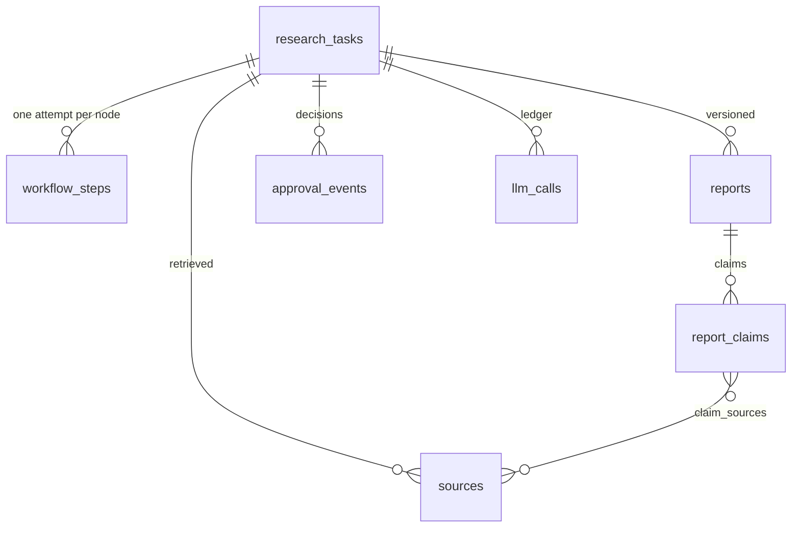

# Data model

Nine tables, one migration. Generated by SQLAlchemy models in
`backend/app/db/models.py` and applied by Alembic; `alembic check` is the
guarantee that the two agree.

## Why there are two stores, and which one wins

| Store | Authoritative for | Read by |
|---|---|---|
| These tables | display, audit, every API response | API, UI, tests |
| LangGraph checkpoints (`langgraph` schema, library-managed) | resume after restart | the worker only |

Both are written in the same unit of work, so they cannot diverge, and
nothing reads the checkpointer to answer an API request. Alembic is configured
to ignore the library's tables (`migrations/env.py:include_object`) so
autogenerate does not try to drop them.

## Entities

| Table | Purpose | Key constraints |
|---|---|---|
| `research_tasks` | the request and its lifecycle | `UNIQUE(session_id, idempotency_key)`; question length 10–2000; partial index on `status` where not deleted |
| `workflow_steps` | one attempt at one node | **`UNIQUE(task_id, node, attempt)`** |
| `sources` | retrieved evidence | **`UNIQUE(task_id, url_sha256)`** |
| `reports` | versioned output | **`UNIQUE(task_id, version)`**, `superseded_by` |
| `report_claims` | per-claim support verdict | `UNIQUE(report_id, ordinal)`, index on `support_status` |
| `claim_sources` | claim → source evidence | composite PK |
| `approval_events` | immutable human decisions | indexed by `(task_id, created_at)` |
| `llm_calls` | per-call cost/latency ledger | token counts non-negative |
| `demo_budget` | daily USD ceiling | one row per UTC day |

## Design notes

**Status is coarse.** `research_tasks.status` has six values and per-node
progress lives in `current_node`. A status per node would couple the API
contract to the graph's shape, so adding a node would be a breaking API
change.

**`UNIQUE(task_id, node, attempt)` is the retry-safety mechanism.** A
duplicated or re-delivered worker job cannot write a second row for the same
attempt. A genuine retry is a new attempt number, so failures stay visible in
the timeline instead of being overwritten.

**Revisions version, they never overwrite.** `reports` is append-only per
task; `superseded_by` links the old version forward. Approval events record
the version they applied to, so approval history survives a revision.

**`report_claims` exists so honesty is queryable.** Keeping claim support in
a table rather than in report prose is what makes *"unsupported claims are
flagged, not silently treated as verified"* an assertion in SQL rather than a
promise in a README.

**`llm_calls` separates `model_requested` from `model_served`.** They differ
whenever the fallback chain fires, so the ledger stays truthful about which
model actually wrote a report. Both `cost_usd_estimate` (ours, from catalogue
pricing) and `cost_usd_reported` (the gateway's) are stored, because they can
legitimately diverge.

**Provenance on every task.** `search_mode` and `llm_provider` are written
from resolved configuration, so a report's limitations section can state
whether it came from fixtures and a stub, and cannot drift from reality.

**Enums are VARCHAR + CHECK, not native PostgreSQL enums.** Native enums need
a migration to add a value. The CHECK constraints are created explicitly:
SQLAlchemy's `native_enum=False` defaults to `create_constraint=False`, which
would leave a bare VARCHAR that any client could write nonsense into. A test
asserts the constraint exists in `pg_constraint`.

## Retention and privacy

`research_tasks.deleted_at` supports soft delete; queries filter on NULL.
`ON DELETE CASCADE` on every child means a hard delete removes the complete
history of a task — steps, sources, reports, claims, evidence links, approval
events and ledger rows. The retention job (M4) depends on that, and an
automated test asserts no orphans survive: leftover visitor research content
is a privacy problem, not just untidy data.

Prompts are never persisted. `workflow_steps.input_summary` is a short
human-readable summary, because a prompt carries untrusted retrieved content.
