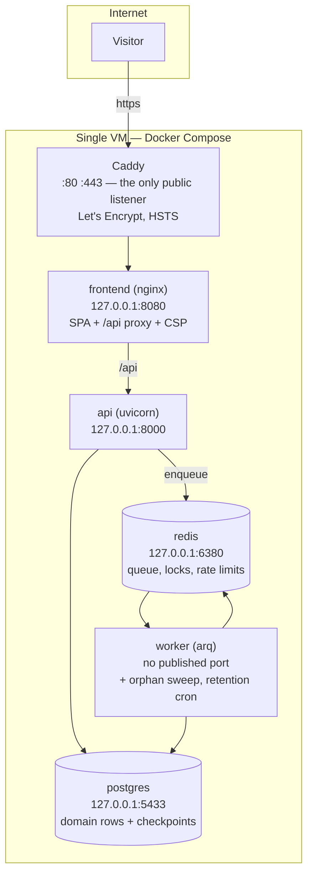

# Deployment

> **Nothing is deployed.** This describes a procedure that has been prepared
> and locally verified, not one that has been carried out. Five gates must be
> cleared first — see [Deployment gates](security.md#deployment-blockers).

## The recommended architecture

**One always-free VM running the existing Compose stack**, with Caddy
terminating TLS.



Why this shape rather than a managed platform: the architecture needs an
always-on background worker, two cron schedules, a persistent Postgres and a
Redis that tolerates a polling queue. The free tiers that exist in November
2026 do not supply that combination — the reasoning, with measurements, is in
[the M7A report](milestones/m7a-report.md#hosting).

The compromise it accepts is honest: one host is a single point of failure,
TLS and backups are ours to run, and the free VM carries an idle-reclaim
policy. In exchange the deployed topology is *identical* to the one developed
and tested, which is worth more than managed convenience for a demonstration.

## Before deploying

| Gate | Status |
|---|---|
| Access control for live research | implemented, tested |
| Daily usage and spend ceilings | implemented, tested |
| Per-session task limits | implemented, tested |
| Rate limiting under concurrency and Redis failure | implemented, tested |
| Hosted secret handling | **procedure written, never executed** |

The first four are enforced at admission and verified by
`scripts/abuse-check.sh` against a running stack. The fifth is below, and has
not been carried out because no host exists.

## Secret handling

**Nothing secret is in the repository and nothing secret is baked into an
image.** Secrets reach the containers one way: a `.env` file on the host, read
by Compose at start.

```bash
# On the host, once.
umask 077                                   # the file is created 600
cp deploy/.env.production.example .env
openssl rand -hex 32   # -> SESSION_SECRET
openssl rand -hex 16   # -> DEMO_ACCESS_CODE
openssl rand -base64 32  # -> POSTGRES_PASSWORD
$EDITOR .env
chmod 600 .env && chown root:root .env
```

Rules that the rest of the system already enforces:

- **The image contains no credential.** `docker history` on any image shows no
  secret, because none is passed as a build argument.
- **Secrets never reach a log.** The structured logger redacts credential-shaped
  values, and a test asserts a configured key does not appear in any error
  response.
- **A visitor cannot supply or select credentials.** The request schema forbids
  unknown fields and the API accepts no model or key parameter.
- **A rotated key needs no rebuild**: edit `.env`, `docker compose up -d`.

**For the zero-cost public demo, leave `LLM_PROVIDER=stub` and
`SEARCH_PROVIDER=fixture`.** Then there is no provider credential on the host
at all, which is the strongest form of secret handling available.

## Deploying

```bash
# 1. Host prerequisites: Docker Engine + the compose plugin, ports 80/443 open.
# 2. Clone and configure.
git clone https://github.com/snmshahzaib/agentflow.git && cd agentflow
cp deploy/.env.production.example .env && $EDITOR .env    # see above

# 3. Point DNS at the host first -- Caddy needs to answer the ACME challenge.
dig +short $DEPLOY_DOMAIN

# 4. Start.
docker compose -f docker-compose.yml -f deploy/docker-compose.prod.yml up -d --build
```

Migrations run automatically: the `migrate` service applies `alembic upgrade
head` and the API waits for it to complete successfully.

## Health checks

```bash
curl -fsS https://$DEPLOY_DOMAIN/ready | jq        # database, queue, llm
curl -fsS https://$DEPLOY_DOMAIN/health            # liveness only
docker compose ps                                  # every service healthy
```

`/ready` reports each component separately and returns `ready: false` if any
is down — verified by stopping Redis and watching it flip, then recover
without restarting the API.

Post-deploy verification, in order:

```bash
scripts/smoke-test.sh https://$DEPLOY_DOMAIN       # submit -> gate -> approve
scripts/abuse-check.sh https://$DEPLOY_DOMAIN      # limits, isolation, outage
```

`abuse-check.sh` refuses to run against anything but the offline profile, so
it cannot hammer a live deployment.

## Rollback

Images are tagged by commit, so rollback is a checkout and a restart:

```bash
git log --oneline -5
git checkout <previous-sha>
docker compose -f docker-compose.yml -f deploy/docker-compose.prod.yml up -d --build
```

**Migrations are the part that needs thought.** Alembic downgrades are written
and tested in both directions, but rolling an application back across a
migration that dropped a column loses the data in it. The procedure:

1. Roll the application back first and confirm `/ready`.
2. Only downgrade the schema if the new revision is actually incompatible:
   `docker compose run --rm migrate alembic downgrade -1`.
3. If the forward migration was destructive, restore from the backup below
   instead of downgrading.

## Backups

```bash
# Nightly, to the host filesystem; copy off-host for anything that matters.
docker compose exec -T postgres pg_dump -U agentflow agentflow \
  | gzip > "backup-$(date -u +%F).sql.gz"
```

Restore:

```bash
gunzip -c backup-YYYY-MM-DD.sql.gz \
  | docker compose exec -T postgres psql -U agentflow -d agentflow
```

Retention deletes visitor research after `DATA_RETENTION_DAYS`, so a backup
older than that window will restore data the retention policy has deleted.
Keep backups for operational recovery, not as an archive.

## What is deliberately not here

- **No Kubernetes, Terraform or service mesh.** One VM and a Compose file is
  the right amount of infrastructure for this, and anything more would be
  resume-driven.
- **No CDN or multi-region.** No performance target requires it, and none is
  claimed.
- **No autoscaling.** The worker's concurrency is capped deliberately, because
  the binding constraint is a provider allowance rather than CPU.
